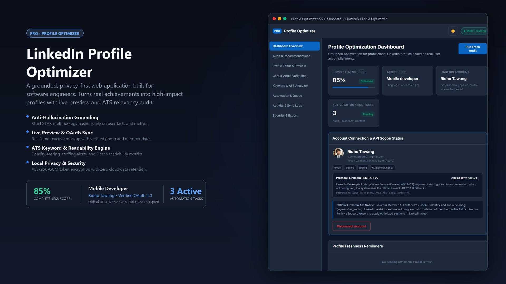

# LinkedIn Profile Optimizer



A focused, privacy-first web application built to help software engineers audit, structure, and maintain their LinkedIn profiles. Grounded in real metrics, official LinkedIn OAuth 2.0 integration, and applicant tracking system (ATS) keyword analysis.

## Key Capabilities

### 1. Grounded Profile Optimization
- Generates targeted headlines within the 220-character limit based on target role, technical skills, and core engineering strengths.
- Writes summary narratives in Indonesian (id) or English (en) without generic buzzwords or hollow marketing jargon.
- Structures work history entries using the STAR (Situation, Task, Action, Result) framework with quantified metrics.
- Enforces strict anti-hallucination rules: experiences, companies, degrees, certifications, and metrics are derived solely from user input.
- Provides 3 positioning angles: Technical Depth, Impact & Product Value, and Team Leadership.

### 2. Live LinkedIn Preview & Identity Sync
- Live desktop mockup reflects profile edits in real time.
- Renders verified LinkedIn member photo directly from OAuth 2.0 OpenID Connect with initial fallback.
- Displays verified member email and profile location automatically.
- Live reactive synchronization across headline, summary narrative, skills cloud, and work experience entries.

### 3. Interactive Skills Taxonomy
- Searchable taxonomy covering 44+ engineering technologies across Mobile, Frontend, Backend, Cloud/DevOps, Database, and Architecture.
- Filter skills by technical category with single-click badge toggling.
- Full support for custom skill inputs and rapid comma-separated keyboard entry.
- Direct live preview synchronization into the LinkedIn mockup skill chips.

### 4. Experience Templates & Role Auto-Generation
- Seven grounded profession presets with battle-tested responsibilities and verified metrics:
  - Senior Flutter & Mobile Engineer
  - Senior Frontend Developer
  - Senior Backend Engineer
  - Senior Fullstack Engineer
  - DevOps & Cloud Platform Engineer
  - QA Automation Engineer
  - Technical Lead / Engineering Manager
- Smart role auto-generation: analyzes target role, headline, and selected skills to build a complete work history item with quantified impact metrics (e.g. 99.8% crash-free rate, latency reductions, test coverage).
- Full bilingual support in Indonesian and English.

### 5. ATS Keyword & Readability Analyzer
- Analyzes keyword frequency and warns against keyword stuffing (density > 3.5%).
- Compares profile content against standardized technology taxonomies and target job descriptions.
- Calculates Flesch Reading Ease score and average sentence length.
- Produces an ATS Match Score (0 to 100%) to ensure resume and profile discoverability.

### 6. Official LinkedIn OAuth 2.0 Integration
- Implements official OAuth 2.0 with PKCE (S256 code challenge) and state verification.
- Supports official LinkedIn products and scopes:
  - openid: OpenID Connect member identity
  - profile: Member name and profile picture URL
  - email: Primary verified email address
  - w_member_social: Publishing feed posts with explicit user consent
- LinkedIn Posts API version 202609 compliant.
- Respects LinkedIn Member API boundaries: LinkedIn standard APIs do not allow third-party self-serve applications to modify member resume sections directly. The optimizer provides 1-click clipboard export and structured step-by-step guidance.

### 7. Automation with Explicit User Approval
- Scheduled audits of profile completeness and keyword alignment.
- Freshness reminders for roles or skills unreviewed for 30+ days.
- Content draft generation for engineering posts.
- Human-in-the-loop approval: no external post is published without explicit user review.
- Idempotency keys prevent duplicate post submissions.
- Automatic rate limit (HTTP 429) backoff handling.

### 8. Privacy, Security & Data Isolation
- Tokens encrypted at rest using AES-256-GCM with authenticated tags.
- Sensitive credentials (tokens, client secrets, session keys) are redacted in server logs.
- Multi-user tenant isolation: each user profile, revision history, and OAuth token is strictly separated in SQLite.
- One-click account disconnect and permanent data purge options to revoke tokens and wipe stored profile records.
- Comprehensive HTTP security headers (nosniff, DENY frame options, strict referrer policy, permissions policy).

### 9. Multi-Format Export
- Export profile directly to structured Markdown (.md), clean Plain Text (.txt), and valid JSON (.json).

## Technology Stack

- Runtime: Node.js (v24.15.0+)
- Server Framework: Express 5 (ES Modules)
- Database: SQLite with better-sqlite3 (WAL mode, foreign key enforcement)
- Validation: Zod schemas
- Cryptography: Node native crypto (AES-256-GCM, SHA-256, PKCE)
- Frontend: Semantic HTML5, Vanilla CSS with custom design system (WCAG AA compliance), Modular ES6 JavaScript
- Testing: Node native test runner (node --test)

## Directory Structure

```
├── .env.example
├── .env
├── package.json
├── README.md
├── src/
│   ├── config.js
│   ├── app.js
│   ├── server.js
│   ├── db/
│   │   ├── database.js
│   │   └── schema.js
│   ├── middleware/
│   │   ├── authMiddleware.js
│   │   ├── rateLimiter.js
│   │   └── errorHandler.js
│   ├── routes/
│   │   ├── authRoutes.js
│   │   ├── profileRoutes.js
│   │   ├── auditRoutes.js
│   │   ├── automationRoutes.js
│   │   ├── exportRoutes.js
│   │   └── settingsRoutes.js
│   ├── services/
│   │   ├── cryptoService.js
│   │   ├── linkedinOAuthService.js
│   │   ├── linkedinApiService.js
│   │   ├── mcpClientService.js
│   │   ├── linkedinIntegrationAdapter.js
│   │   ├── aiProviderService.js
│   │   ├── profileOptimizerService.js
│   │   ├── keywordAnalyzerService.js
│   │   ├── automationService.js
│   │   └── exportService.js
│   └── utils/
│       ├── envValidator.js
│       ├── keyRotation.js
│       ├── generateSecrets.js
│       ├── logger.js
│       └── validators.js
├── public/
│   ├── index.html
│   ├── privacy.html
│   ├── css/
│   │   └── styles.css
│   ├── js/
│   │   ├── api.js
│   │   └── app.js
│   └── images/
│       └── linkedin-banner.jpg
└── test/
    ├── aiProvider.test.js
    ├── automation.test.js
    ├── envValidation.test.js
    ├── export.test.js
    ├── keyRotation.test.js
    ├── keywordAnalyzer.test.js
    ├── mcpClient.test.js
    ├── multiUserIsolation.test.js
    ├── noCommentsCheck.test.js
    ├── oauth.test.js
    ├── profileOptimizer.test.js
    └── security.test.js
```

## Setup & Installation

### 1. Install Dependencies
```bash
npm install
```

### 2. Generate Local Encryption Secrets
Run the secret generator to produce distinct 32-byte (64 hex character) keys:
```bash
npm run generate-secrets
```

### 3. Configure Environment Variables
Copy `.env.example` to `.env` and fill in your LinkedIn Developer App credentials:
```bash
PORT=3000
NODE_ENV=development
APP_SECRET=your_generated_64_character_hex_secret
ENCRYPTION_KEY=your_generated_64_character_hex_key
LINKEDIN_CLIENT_ID=your_client_id
LINKEDIN_CLIENT_SECRET=your_client_secret
LINKEDIN_REDIRECT_URI=http://localhost:3000/auth/linkedin/callback
LINKEDIN_SCOPES=openid,profile,email,w_member_social
DATABASE_PATH=./data/optimizer.db
SESSION_MAX_AGE_MS=86400000
RATE_LIMIT_WINDOW_MS=60000
RATE_LIMIT_MAX_REQUESTS=120
LINKEDIN_MCP_SERVER_URL=
LINKEDIN_MCP_ENABLED=false
AI_PROVIDER=grounded
AI_API_KEY=
```

### 4. LinkedIn Developer Portal Setup
1. Go to https://developer.linkedin.com and create an application.
2. Under Products, add "Sign In with LinkedIn using OpenID Connect" and "Share on LinkedIn".
3. Under Auth, add Authorized Redirect URL: `http://localhost:3000/auth/linkedin/callback`.
4. Copy Client ID and Client Secret into your `.env` file.

### 5. Start the Application
```bash
npm start
```
The application will be available at http://localhost:3000.

### 6. Run Automated Tests
```bash
npm test
```
Runs all 46 unit, integration, and security tests across 12 test suites.

To check comment hygiene across the repository:
```bash
npm run check-comments
```

## Code Quality & Engineering Principles

- Zero code comments policy enforced automatically across the codebase.
- No em dashes in copy or documentation.
- Strict WCAG AA contrast standards across light and dark themes.
- Anti-hallucination grounding: every recommendation requires real user input and facts.
- Honest error handling and informative empty states without placeholder filler.
